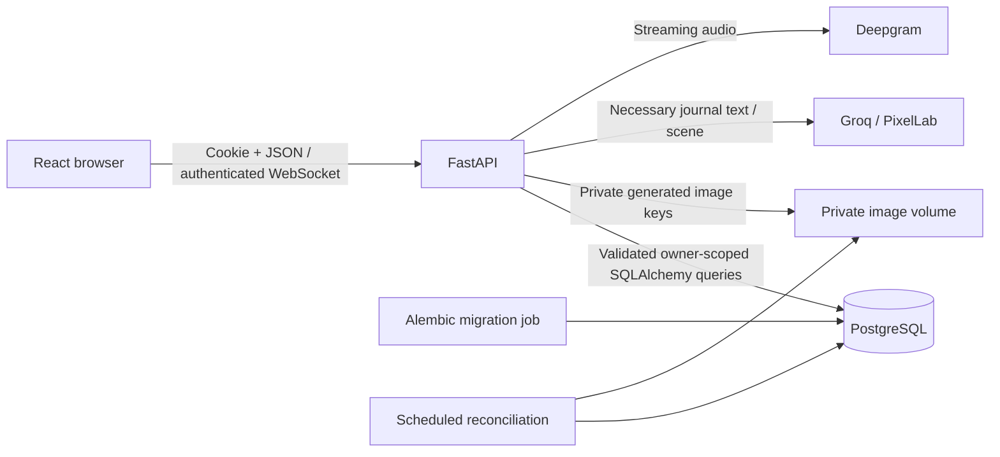
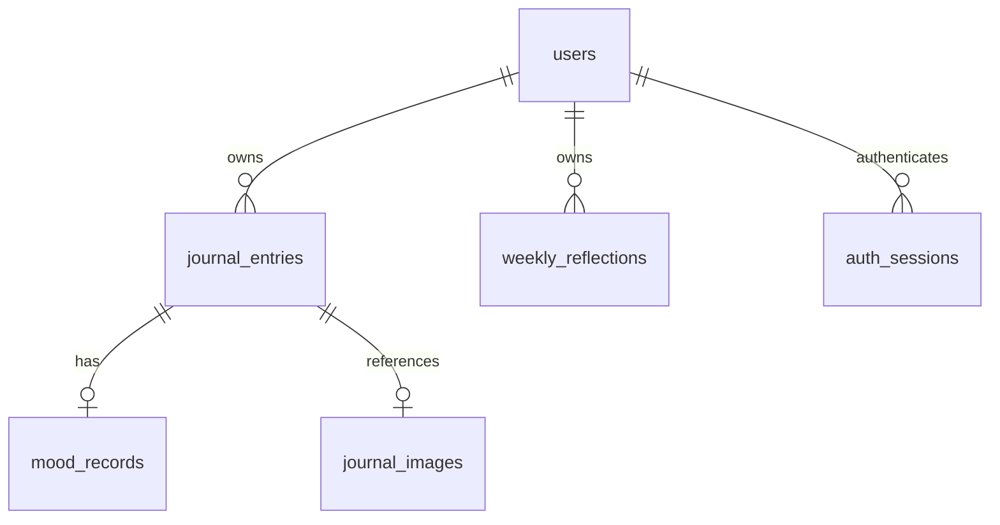

# AuraJournal data and security: architecture and defense guide

This is the current implementation overview for the project defense. Read this
first, then use [security rules](security-rules.md) for product requirements,
[security hardening](security-hardening.md) for deployment instructions, and
[database migrations](database/migrations.md) for schema operations. Requirements
and deployment recommendations are distinguished from features implemented in code.

## 1. What the system can do

AuraJournal is a private journal application with authenticated accounts. It saves
journal text and selected journal dates, per-entry AI summaries, weekly reflections
with two questions, optional mood values, and references to privately stored images.
It can retrieve one entry, list an owner's entries, count entries by calendar day,
calculate a current writing streak, and select seven days of journals for reflection.

| Requirement | Implementation and evidence |
| --- | --- |
| Persist user-owned reflections and image references | `weekly_reflections` uses an owner/period key; `journal_images` references an owned entry. Authenticated APIs save/read both. The Groq reflection provider is connected and the reflection page reads saved snapshots and explicitly regenerates them. |
| Safe image storage and lifecycle | Private filesystem, application-generated keys, authenticated byte retrieval, row/advisory locks, rollback recovery, and orphan reconciliation. The filesystem and PostgreSQL are coordinated but are not one atomic transaction. |
| Repeatable multi-user development data | `python -m scripts.setup_data` migrates an explicitly selected disposable database and seeds 12 deterministic journals across two disabled sample accounts. Repeated execution preserves samples. |
| Indexed queries and upgrades | Composite owner/date index supports day/range queries. Alembic revisions preserve existing records and tests compare the migrated database to ORM metadata. A synthetic query-plan tool measures the actual planner behavior. |

The legacy weekly recap is a separate feature: `/api/reflections/weekly` returns
summary/highlights based on creation timestamps and does not save a weekly row.
`/api/weekly-reflections` uses selected journal dates and saves summary/questions.
The UI exposes the saved reflection separately so these meanings remain clear.

## 2. Architecture and trust boundaries



The browser cannot choose its database owner. FastAPI resolves identity from the
session cookie and supplies the authenticated user's UUID to queries. PostgreSQL
stores relationships and checks data integrity. Image files are outside the public
web directory; the API authorizes access before returning bytes. AI keys remain on
the backend. External providers receive data needed for the requested operation;
application privacy does not mean that no third party processes journal content.

## 3. Data structure

The current Alembic head is **0009**. PostgreSQL has eight application tables plus
`alembic_version`, which records the applied schema revision.

| Table | Key and important fields | Responsibility |
| --- | --- | --- |
| `users` | UUID `id`; unique normalized `email`; `password_hash`; timestamps | Account identity. Passwords use Argon2id hashes. |
| `journal_entries` | UUID `id`; required `user_id`; `content`; `journal_date`; timestamps; nullable AI summary/question/generation time | Owned journal and its saved per-entry AI result. |
| `mood_records` | UUID `id`; unique required `entry_id`; `valence`, `arousal` floats | Optional one-to-one mood data. Numeric clinical ranges are not enforced. |
| `journal_images` | UUID `id`; unique required `entry_id`; `image_url`; `file_format`; creation time | Optional one-to-one image reference. `image_url` is an internal storage key, not a public URL. |
| `weekly_reflections` | Composite primary key `(user_id, period_start)`; `summary`; JSONB `questions`; nullable JSONB `source_dates`; timestamps | One saved reflection per owner and chosen seven-day start date. |
| `auth_sessions` | SHA-256 `token_hash` primary key; required `user_id`; `expires_at` | Revocable seven-day sessions; the raw cookie token is not stored. |
| `login_attempts` | UUID `id`; normalized email; client IP; creation time | Failed-login throttling and expiry cleanup. |
| `rate_limit_buckets` | Hashed `key`; positive `attempts`; `expires_at` | Shared request budgets across backend workers. |



Foreign keys reject nonexistent owners/parents. Unique entry foreign keys permit
at most one mood row and one image row per entry. Deleting a user in SQL cascades
to their sessions, journals and weekly reflections; journals cascade to mood/image
rows. These database cascades do not delete filesystem bytes. Reconciliation
removes orphan files afterward. There is currently no public account-deletion API.
Login-attempt and budget rows are operational data with time-based cleanup, not
children of a user row.

The reflection database constraint requires a nonblank summary and exactly two
nonblank JSON strings. API validation additionally limits summary/question lengths
to 2,400/300 characters. Database constraints protect direct SQL writers; API
validation provides a stricter user-facing contract. JSONB is appropriate here
because the ordered pair of questions is read and replaced as one small document.

`journal_date` is a PostgreSQL `DATE`: the day the user assigns to a journal.
`created_at` and `updated_at` are timezone-aware timestamps: when a record was
created and changed. New dates default to the UTC+7 (`Asia/Bangkok`) transaction
date. Editing the selected day preserves creation time. ORM writes update
`updated_at`; raw SQL writers must set it themselves. There is no timestamp trigger.
Historical dates were backfilled from the UTC+7 creation day because no selected
day existed in the original schema.

## 4. How the application navigates data

Navigation means following a user's authenticated identity through the relevant
relationships and filters, rather than letting the browser query arbitrary rows.

| User action | Database path and result |
| --- | --- |
| Sign in | Normalize email → find account → verify Argon2id hash → store hash of a random session token → set cookie. Subsequent requests resolve session hash → user. |
| Write a journal | Validate text/date → insert journal with session-derived owner UUID → commit → return safe response fields. |
| Open/edit/delete an entry | Filter by both entry UUID and owner UUID. Mutations lock the owned row. Missing and another owner's rows return 404. |
| Browse calendar | Filter by owner and inclusive journal-date range → group/count by date. API fills absent days with zero. |
| Show streak | Search the owner's today/yesterday dates, then walk backward through consecutive occupied journal days. Duplicate entries count once; future days and another owner's records do not count. |
| Generate saved reflection | Select only the owner's seven-day sources → release the read transaction → call provider → validate output → recheck source snapshot → upsert owner/period row → commit. |
| Read saved reflection | Composite lookup `(authenticated user.id, period_start)`; no provider call is needed. |
| Display image | Authorize entry owner → follow image relation → validate internal key → read private file → return PNG bytes with private response headers. |

Saved reflections now persist source dates checked against the selected journals.
Historical rows have null source dates; the application does not invent evidence
from current journals.

The saved reflection is a snapshot, not a live view. Later journal edits/deletions
do not silently rewrite it. Explicit regeneration updates the same row, preserves
`created_at`, and refreshes `updated_at`. Empty periods do not overwrite a previous
snapshot. Invalid provider output, provider failure, detected source changes, and
failed commits preserve the previous saved result. The source recheck is a
point-in-time check, not a lock preventing all later edits; concurrent successful
generations use last-write-wins behavior.

Text changes invalidate the entry's old summary/question and image reference;
date-only edits preserve those content-derived assets. The filesystem file is
removed after the database commits, so a failed database write cannot delete a
still-referenced file. Failed cleanup is recoverable by reconciliation.

## 5. Transactions, indexes, and migrations

SQLAlchemy maps Python objects to tables and uses bound parameters for queries.
Request-scoped sessions close after use; commits define durable changes and failed
transactions are rolled back on session closure. Foreign keys and uniqueness are
enforced by PostgreSQL, including concurrent writers. ORM relationships simplify
navigation but do not themselves authorize requests.

The index `(user_id, journal_date, created_at, id)` puts owner equality first,
then date filtering, then deterministic tie-breakers. Range browsing orders by
selected date, creation time and UUID. Owner/date queries avoid scanning unrelated
accounts. The legacy full entry list still sorts by creation timestamp and is
unpaginated; this index is not a promise that every query has optimal performance.

Other primary/unique indexes support UUID lookup, normalized email, one image/mood
per entry, and owner/period reflections. Session owner/expiry indexes and failed
login/budget indexes support authentication and expiry cleanup. Indexes trade extra
storage and write work for faster reads; they do not enforce authorization.

Run `python -m scripts.explain_journal_queries` from `src/backend` with an explicit
disposable `TEST_DATABASE_URL`. It inserts 20,000 synthetic journals, analyzes the
table and prints `EXPLAIN (ANALYZE, BUFFERS, FORMAT JSON)` for day lookups/month
counts. Synthetic rows roll back even on failure. It requires a test/migration
role able to run ANALYZE, not the restricted production role.

One local PostgreSQL 18 run used the owner/date index for both queries: backward
index-only scan for day lookup (10 rows, 0.016 ms execution) and bitmap index/heap
scan for monthly counts (290 source rows, 0.076 ms execution). These warm local
measurements demonstrate index use, not a production latency guarantee. The
planner remains free to choose a sequential scan for small/unselective tables.

Migration order: legacy table `0001` → UUID ownership/child tables `0002` → sessions
`0003` → entry AI fields `0004` → journal date/backfill `0005` → weekly storage
`0006` → browse index `0007` → shared budgets/login indexes `0008` → saved reflection source dates `0009`.
The local `npm start` launcher runs Alembic before launching the apps; the FastAPI
process itself does not create/upgrade tables. Production should run migrations
as a separate deployment job before starting the restricted API process.
Use separate migration-owner and restricted runtime credentials in production.
Tests verify fresh/legacy upgrades, repeat upgrades, schema/model parity and
selected downgrade/re-upgrade paths. Downgrade can lose selected dates/reflections;
`0002` cannot restore original numeric IDs. Backups are the recovery mechanism.

## 6. Implemented security controls and their limits

| Control | Implemented behavior | Boundary or limitation |
| --- | --- | --- |
| Password security | Argon2id; normalized unique emails; 15–128-character new-password policy; local weak-password list; rehash on login | No email verification, recovery or comprehensive breached-password service. Duplicate registration reveals that an email exists. |
| Sessions | Random cookie token; SHA-256 hash stored; seven-day expiry; server-side logout revocation; HttpOnly and SameSite=Lax cookie scoped to `/api` | Secure flag is configurable locally and mandatory in production. No revoke-all/idle-expiry feature. Hashing is not encryption. |
| Ownership | Session-derived owners, owner-scoped selects/mutations/media/reflections, 404 for another account's resource | Application-level isolation; PostgreSQL RLS is not enabled. A privileged direct SQL client is outside this authorization boundary. |
| Browser protection | Exact configured Origin and custom CSRF header for HTTP writes; JSON content type; narrow credentialed CORS; WebSocket origin/session checks | CORS is not authorization. The proxy must be configured correctly. |
| Abuse controls | PostgreSQL-backed registration/login limits; shared title/summary budgets; body limit 65,536 bytes; image generation locks and capacity bounds; bounded audio transport | Shared AI quotas currently cover title/summary only. Saved weekly/image/transcription requests do not inherit those quotas; image concurrency limits are separate. |
| Output/errors | `no-store`, `nosniff`, `no-referrer`; production HSTS; validation responses omit submitted input; generic database/provider errors | Operational logs/proxy settings still require deployment review. Plain React text rendering is used; no HTML rendering is needed for reflections. |
| Private media | Backend-only storage keys; traversal/symlink checks; file size limits; authenticated reads; cleanup/recovery | Trusted administrators control the storage directory. Files and PostgreSQL are separate resources, and host compromise is outside this control. |
| Production posture | HTTPS origin, Secure cookie, verified DB TLS, non-default credentials, restricted non-owner runtime role and wrong-password rejection checked | Hosting, certificates, disk/backup encryption, schedule installation, restore drills and monitoring remain operator responsibilities. |
| AI boundary | Necessary owner-filtered sources, untrusted-source prompts, JSON validation, generic errors; explicit generation action | Prompts cannot guarantee factuality or prevent every prompt injection. Provider retention/deletion is separate from app deletion. No live-model quality certification is claimed. |

Audio is streamed in bounded memory; the backend does not persist raw recordings.
The browser/transcription workflow and provider behavior have separate cleanup and
privacy boundaries. See [speech-to-text](speech-to-text.md). Mood fields and image
scenes are product features, not clinical assessments.

No application-level encryption of journal text is implemented. A database dump
contains readable private content. HTTPS protects transport; Argon2 protects
password verification; neither encrypts stored journals. Disk and backup encryption
must be configured in the deployment. Public sharing, OAuth login, and public
account deletion are not implemented by these data tasks.

## 7. Image storage decision and operations

The MVP uses a **private persistent filesystem volume**, not public URLs or image
blobs in PostgreSQL. PostgreSQL stores a small key such as
`pixel-art/<entry-uuid>/<image-uuid>.png`; files contain the bytes. This keeps
relational backups smaller but requires coordinated volume backup and recovery.
All workers must use the same volume and database. Object storage would require a
new backend adapter plus equivalent authorization, cleanup and backup behavior.

Generation writes a private temporary file, flushes it, atomically renames it,
and inserts its reference while holding the owned entry lock. PostgreSQL advisory
locks coordinate generation/reconciliation across workers. On an uncertain COMMIT,
the API rechecks whether a file is referenced and retains it when the database
cannot establish safety. It never guesses that an uncertain file is disposable.

Configure `JOURNAL_IMAGE_STORAGE_DIR` to a durable, access-restricted path outside
the web root. The default ignored `var/journal-images` is convenient for local use.
Schedule `python scripts/cleanup-journal-images.py` hourly and after restarts,
against the same DB/volume/env as the API. For a Linux scheduler, after replacing
paths, configure environment securely in the scheduler/service configuration:

```cron
0 * * * * cd /srv/AuraJournal && /srv/AuraJournal/.venv/bin/python scripts/cleanup-journal-images.py
```

Monitor failed executions. Cleanup skips active generation and referenced images,
removes owned orphan PNG/temporary files, and refuses foreign keys. An hourly
schedule is an operational target, not an enforced deletion SLA during outages.
No scheduler is installed on your machine by this repository change.

For a consistent backup, stop API writers and cleanup workers, create a private
PostgreSQL custom-format dump, and copy/archive the configured image directory as
one backup set. Record the Alembic revision and storage path, then restart workers.
Use encrypted backup storage with access control and retention outside Git.
Restore both parts to a scratch database/private directory first. Verify revision,
row counts, relationships and that every referenced image is readable through its
owner's API while another owner receives 404. Only after that check should cleanup
run. Do not reconcile a database against a partially restored image volume.
Database restore alone cannot recover lost image bytes. Account deletions must be
reapplied after restoring older backups according to the operator's retention policy.

## 8. Reproducing the defense demonstration

Use fictional disposable data. From `src/backend`, with the virtual environment
active, set `TEST_DATABASE_URL` securely, then:

```sh
python -m scripts.setup_data
python -m scripts.setup_data
python -m scripts.demo_calendar
python -m scripts.explain_journal_queries
python -m pytest tests -q
```

Setup does not create the PostgreSQL database itself; create an empty test database
using the [setup guide](database/create-and-test.md) first. The setup tool applies
Alembic and seeds the deterministic sample rows. The two sample accounts cannot
log in because their password fields are disabled markers. For a browser demo,
register separate fictional accounts through the UI; do not enable seed accounts
by substituting a shared plaintext password.

Demonstrate Alice's five November-boundary entries and Bob's three; Alice has two
entries on Oct 31 but her Nov 1 streak is three days. Bob's Nov 2 entry cannot fill
Alice's gap. Four additional backdated samples show Feb 29 in the selected calendar
despite being created in 2026. See [calendar and streak](calendar-and-streak.md).

For saved reflection generation configure backend `GROQ_API_KEY` (and optionally
`GROQ_MODEL`). Without credentials, saved reads still work and generation fails
safely with 503. Automated tests use fake providers; real generation is an explicit
external operation. Image generation also requires enabled PixelLab configuration.

## 9. Questions to prepare for the defense

- **Why PostgreSQL?** Strong relationships, constraints, transactions, UUID/date
  types, JSONB for the small question document, and indexed owner/date queries.
- **How do you prevent another user's access?** Resolve the session on the backend
  and filter by both owner and resource. Foreign keys prevent orphan rows but do
  not replace ownership checks. Tests use multiple independent accounts.
- **Why keep a journal date separate from timestamps?** Backdating changes the
  calendar meaning without falsifying when the record was actually created.
- **Why is an image not stored as a public URL?** A public URL bypasses the app's
  ownership checks. The private key is resolved only after authentication.
- **What if the database or file write fails?** Roll back database changes, preserve
  a previously saved result, and reconcile files only after checking references.
  A DB transaction cannot atomically include a filesystem write.
- **What is not finished?** Production infrastructure verification, account recovery
  and deletion workflows, OAuth, RLS, full-list pagination, broader provider quotas,
  AI factuality evaluation, and formal provider/backup retention policies.
- **How do you prove correctness?** Repeatable multi-user samples, real PostgreSQL
  migration/privacy/lifecycle tests, mocked provider error paths, and measured
  query plans. These are evidence, not a claim of complete production security.

## 10. Verification record for this implementation

Local verification on disposable PostgreSQL 18 / Python 3.15: previous pre-integration full backend suite
**596 passed, 1 skipped** (the explicit administrator role test requires a separate
opt-in URL); frontend **109 passed**; Vite production build passed. Provider calls
were mocked. FastAPI/Starlette emitted Python deprecation warnings. The setup tool
was executed successfully and its repeatability was checked by an integration test.
The 20,000-row plan measurement above was also executed on the disposable database.
The optional administrator role test was then run separately: **1 passed**.
The full suite includes provider-to-storage integration and preservation of AI
fields, mood and image references, weekly reflection content, selected date and
creation timestamp across populated 0007-to-0008 upgrades and repeated upgrades.
An actual custom-format dump/restore drill on the disposable database recovered
revision `0008`, all 12 sample journals and zero orphan ownership references.
This was a database-only drill: it does not certify a deployed encrypted backup
or combined image-volume restore. Image reference/byte lifecycle recovery is
covered separately by the filesystem and API integration tests.

New coverage includes the reflection provider contract, fresh/repeated setup,
benchmark rollback, and database-owner deletion followed by safe image cleanup.
Existing suites verify owner privacy, saved reads across application instances,
generation/commit failure recovery, image lifecycle concurrency, upgrade parity,
authentication and security configuration. No production configuration, live
provider request, scheduler installation, or browser/manual UX verification is
claimed by these results.
